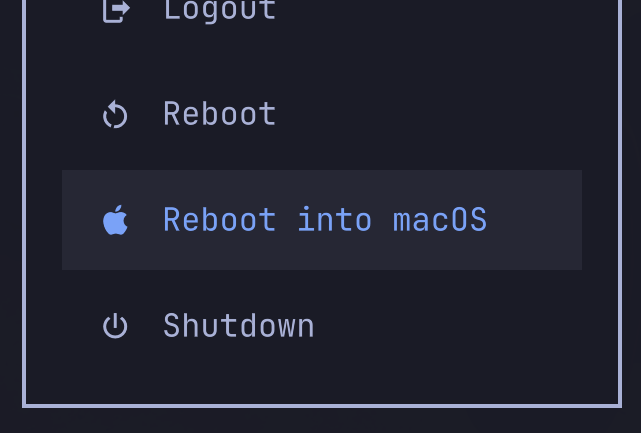

# Reboot into macOS for Omarchy

Adds **Reboot into macOS** between **Reboot** and **Shutdown** in the System menu (Super+Escape). No bar icon.



The action identifies a macOS candidate from **checksummed APFS System-volume and sealed-volume metadata**, rather than its name. Renamed installations work. A native, translated Qt dialog asks for confirmation and selects the target for the **next boot only**. The default startup system is unchanged.

Unsupported metadata, unsealed systems, or several macOS candidates open a picker. A sealed System volume identifies a candidate; it does not certify that the OS is healthy or bootable. Nothing is mounted or written during detection. Duplicate boot labels cannot be selected because the underlying boot tool cannot address them unambiguously by name.

## Requirements

- Apple Silicon Mac running Omarchy Quattro, with a macOS installation.
- `asahi-bless` (including the compatible `aurora-bless` provider).
- Python 3, sudo, polkit (`pkexec`), systemd, and gum (for the optional terminal CLI). The boot tool must support `--next`, `--get-boot`, and `--clear-next`.

## Install

Install this repository with `omarchy plugin add https://github.com/RolandTalvar/omarchy-reboot-macos.git --enable`, or copy the plugin folder into `~/.config/omarchy/plugins/rolandtlvr.reboot-macos/` and run:

```sh
omarchy plugin enable rolandtlvr.reboot-macos
python3 ~/.config/omarchy/plugins/rolandtlvr.reboot-macos/setup.py install
```

Run setup after either installation method. Setup requests administrator authentication **once**. Normal use requires only the reboot confirmation.

Omarchy has no plugin API for inserting System menu rows. Setup explicitly updates `~/.config/omarchy/extensions/omarchy-menu.jsonc`, backing it up first. It preserves unrelated entries and the existing Shutdown command and conditions, hides that original row, and moves an equivalent row after the macOS action. This preserves the requested order. The macOS row is hidden while this plugin's service is disabled.

## Languages

The menu entry, description, confirmation, Yes/No buttons, volume picker, and user-facing failure message follow **Setup > Language**. Catalogs cover all 50 current Omarchy languages. The menu updates live without a shell restart; new terminal actions read the current selection. Missing translations fall back to the base language, then English. Disk names are never translated. The native dialog mirrors right-to-left layouts, wraps text, isolates mixed-direction volume names, and treats window data as plain text. Technical diagnostics and administrator setup output remain in English.

The service uses Omarchy’s `Commons.Translations` and updates only its own existing menu labels (including the relocated Shutdown label). It never creates a missing menu action automatically or replaces a manually changed command. Setup remains an explicit step for installing menu entries and privileges.

Translations are initial translations; corrections from native speakers are welcome. Edit `i18n/<language>.json`, retaining the `%1` placeholder in the confirmation.

### Privileged helper and removal watcher

Setup installs a root-owned helper at `/usr/local/libexec/omarchy-reboot-macos-helper`, trusted modules at `/usr/local/lib/omarchy-reboot-macos`, and a user-specific sudo rule. The helper can list candidates, select a unique candidate for one boot using a stable identity, and clear that selection during recovery. It never grants a general root shell or changes the default startup system. A cleanup guard prevents rollback from clearing a different target selected later.

The root-owned `omarchy-reboot-macos-cleanup.path` unit watches the plugin's parent directory. Removing the plugin through **normal Omarchy removal** triggers a short, delayed check and cleanup. There is no polling or permanent daemon. Trusted cleanup code remains outside the plugin so it still works after the plugin directory is deleted. It drops to the desktop user's privileges before restoring menu settings. The helper, sudo rule, watcher units, root installation record, and trusted module directory are removed. Ordinary plugin updates and a temporarily missing manifest do not trigger cleanup.

Installation supports one desktop user. Updates to privileged code require rerunning `setup.py install` with administrator authentication. A plugin update alone cannot replace privileged code.

### Reboot failure

Rebooting runs in a detached worker so closing the confirmation window cannot hide a failure. If the reboot request fails, the worker tries to clear its one-time boot selection and sends a notification. If clearing fails or another target has since been selected, the notification explains that the next manual restart may still boot macOS. Abrupt power loss or a killed worker cannot run recovery; normal next-boot semantics still apply.

## Remove

Use normal Omarchy removal:

```sh
omarchy plugin remove rolandtlvr.reboot-macos
```

Within a few seconds, the watcher restores the prior menu and removes the privileged components. Menu state tracks this plugin's changes, preserves unrelated edits, and does not overwrite a replacement command the user supplied. An unchanged menu is restored byte for byte, including comments.

To remove only the integration while retaining the plugin checkout:

```sh
python3 ~/.config/omarchy/plugins/rolandtlvr.reboot-macos/setup.py remove
```

If automatic cleanup fails, inspect `journalctl -u omarchy-reboot-macos-cleanup.service` and rerun the explicit removal command. Older user-made backup files remain intentionally. Migration from the pre-plugin local customization restores stock Shutdown; already-lost settings cannot be reconstructed.

## Development

```sh
omarchy plugin validate .
python3 -m unittest discover -s tests -v
python3 tools/render_dialogs.py
python3 tools/render_dialogs.py --picker
```

Tests mock boot-selection and reboot commands. To inspect actual candidates without selecting one:

```sh
sudo -n /usr/local/libexec/omarchy-reboot-macos-helper --list
```

See [VERIFY.md](VERIFY.md) for hardware checks and the pending full boot cycle, and [TRANSLATIONS.md](TRANSLATIONS.md) for honest native-review status. Rendering tests do not establish linguistic correctness.

The metadata reader is deliberately conservative and bounded. See [Apple’s APFS reference](https://developer.apple.com/support/downloads/Apple-File-System-Reference.pdf) and [asahi-bless](https://github.com/aurora-silicon/aurora-bless/blob/main/asahi-bless/src/lib.rs) for the underlying format. The read-only parser borrows the supported object-map approach; Omarchy/Asahi names are not used to identify OS type.

## License

MIT; see LICENSE.
